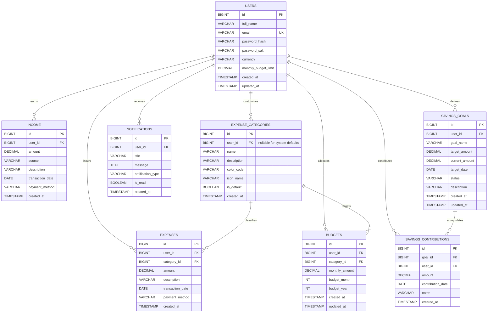

# PennyWise – Database Design & Schema Specification

## 1. Overview
The database for **PennyWise** is designed for MySQL 8.x, adhering to Third Normal Form (3NF) principles. It guarantees referential integrity, supports atomic multi-step operations using ACID transactions, and enforces data isolation between users.

---

## 2. Entity-Relationship Diagram (ERD)

---

## 3. Table Definitions & Constraints

### 3.1 `users`
Stores user authentication and preference settings.
* `id`: `BIGINT AUTO_INCREMENT PRIMARY KEY`
* `full_name`: `VARCHAR(100) NOT NULL`
* `email`: `VARCHAR(150) NOT NULL UNIQUE`
* `password_hash`: `VARCHAR(255) NOT NULL` (PBKDF2-HMAC-SHA512 hashed)
* `password_salt`: `VARCHAR(100) NOT NULL` (Cryptographically secure random salt)
* `currency`: `VARCHAR(10) NOT NULL DEFAULT 'INR'`
* `monthly_budget_limit`: `DECIMAL(15,2) DEFAULT 0.00`
* `created_at`: `TIMESTAMP DEFAULT CURRENT_TIMESTAMP`
* `updated_at`: `TIMESTAMP DEFAULT CURRENT_TIMESTAMP ON UPDATE CURRENT_TIMESTAMP`

### 3.2 `expense_categories`
Categorizes expenses and budget limits. Contains 11 system defaults (`user_id IS NULL`) plus user-defined custom categories.
* `id`: `BIGINT AUTO_INCREMENT PRIMARY KEY`
* `user_id`: `BIGINT NULL`, Foreign key to `users(id)` `ON DELETE CASCADE`
* `name`: `VARCHAR(50) NOT NULL`
* `description`: `VARCHAR(255)`
* `color_code`: `VARCHAR(20) DEFAULT '#2563EB'` (Hex color for charts and badges)
* `icon_name`: `VARCHAR(50)`
* `is_default`: `BOOLEAN DEFAULT TRUE`
* `created_at`: `TIMESTAMP DEFAULT CURRENT_TIMESTAMP`

### 3.3 `income`
Records monetary inflows for a user.
* `id`: `BIGINT AUTO_INCREMENT PRIMARY KEY`
* `user_id`: `BIGINT NOT NULL`, FK to `users(id)` `ON DELETE CASCADE`
* `amount`: `DECIMAL(15,2) NOT NULL CHECK (amount > 0)`
* `source`: `VARCHAR(50) NOT NULL` (SALARY, FREELANCING, BUSINESS, SCHOLARSHIP, INVESTMENTS, GIFTS, OTHER)
* `description`: `VARCHAR(255)`
* `transaction_date`: `DATE NOT NULL`
* `payment_method`: `VARCHAR(50) NOT NULL` (CASH, CREDIT_CARD, DEBIT_CARD, UPI, NET_BANKING, OTHER)
* `created_at`: `TIMESTAMP DEFAULT CURRENT_TIMESTAMP`
* Index: `idx_income_user_date (user_id, transaction_date)`

### 3.4 `expenses`
Records monetary outflows linked to a category.
* `id`: `BIGINT AUTO_INCREMENT PRIMARY KEY`
* `user_id`: `BIGINT NOT NULL`, FK to `users(id)` `ON DELETE CASCADE`
* `category_id`: `BIGINT NOT NULL`, FK to `expense_categories(id)` `ON DELETE RESTRICT`
* `amount`: `DECIMAL(15,2) NOT NULL CHECK (amount > 0)`
* `description`: `VARCHAR(255)`
* `transaction_date`: `DATE NOT NULL`
* `payment_method`: `VARCHAR(50) NOT NULL`
* `created_at`: `TIMESTAMP DEFAULT CURRENT_TIMESTAMP`
* Indexes: `idx_expense_user_date (user_id, transaction_date)`, `idx_expense_category (category_id)`

### 3.5 `budgets`
Allocates monthly spending limits per category for a given month and year.
* `id`: `BIGINT AUTO_INCREMENT PRIMARY KEY`
* `user_id`: `BIGINT NOT NULL`, FK to `users(id)` `ON DELETE CASCADE`
* `category_id`: `BIGINT NOT NULL`, FK to `expense_categories(id)` `ON DELETE RESTRICT`
* `monthly_amount`: `DECIMAL(15,2) NOT NULL CHECK (monthly_amount > 0)`
* `budget_month`: `INT NOT NULL CHECK (budget_month BETWEEN 1 AND 12)`
* `budget_year`: `INT NOT NULL CHECK (budget_year >= 2000)`
* `UNIQUE KEY uq_user_cat_month_year (user_id, category_id, budget_month, budget_year)`

### 3.6 `savings_goals`
Tracks financial milestones and goals.
* `id`: `BIGINT AUTO_INCREMENT PRIMARY KEY`
* `user_id`: `BIGINT NOT NULL`, FK to `users(id)` `ON DELETE CASCADE`
* `goal_name`: `VARCHAR(100) NOT NULL`
* `target_amount`: `DECIMAL(15,2) NOT NULL CHECK (target_amount > 0)`
* `current_amount`: `DECIMAL(15,2) NOT NULL DEFAULT 0.00 CHECK (current_amount >= 0)`
* `target_date`: `DATE NOT NULL`
* `status`: `VARCHAR(30) NOT NULL DEFAULT 'IN_PROGRESS'` (IN_PROGRESS, COMPLETED, CANCELLED)
* `description`: `VARCHAR(255)`

### 3.7 `savings_contributions`
Records deposit contributions into savings goals.
* `id`: `BIGINT AUTO_INCREMENT PRIMARY KEY`
* `goal_id`: `BIGINT NOT NULL`, FK to `savings_goals(id)` `ON DELETE CASCADE`
* `user_id`: `BIGINT NOT NULL`, FK to `users(id)` `ON DELETE CASCADE`
* `amount`: `DECIMAL(15,2) NOT NULL CHECK (amount > 0)`
* `contribution_date`: `DATE NOT NULL`
* `notes`: `VARCHAR(255)`

### 3.8 `notifications`
Stores rule-based alerts generated by the insights engine.
* `id`: `BIGINT AUTO_INCREMENT PRIMARY KEY`
* `user_id`: `BIGINT NOT NULL`, FK to `users(id)` `ON DELETE CASCADE`
* `title`: `VARCHAR(150) NOT NULL`
* `message`: `TEXT NOT NULL`
* `notification_type`: `VARCHAR(30) NOT NULL DEFAULT 'INFO'` (INFO, SUCCESS, WARNING, DANGER)
* `is_read`: `BOOLEAN DEFAULT FALSE`
* `created_at`: `TIMESTAMP DEFAULT CURRENT_TIMESTAMP`

---

## 4. Transaction Integrity & Isolation
- **Atomic Goal Contribution**: Adding savings contributions triggers an atomic JDBC transaction updating `savings_goals.current_amount` and inserting `savings_contributions` in a single transaction block (`setAutoCommit(false)`, `commit()`, with rollback upon error).
- **Referential Integrity**: Cascading deletes for user accounts ensure GDPR-compliant data cleanup, while category deletes are restricted when active expenses rely on them.

