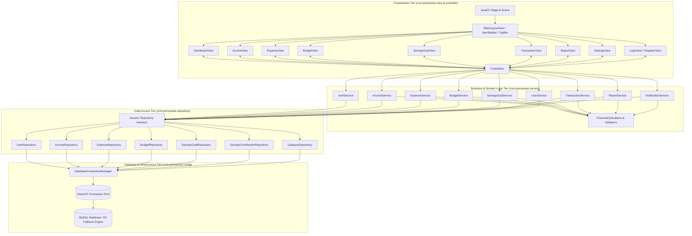

# PennyWise – Project Architecture & Design Documentation

## 1. Architectural Overview
PennyWise follows a strict **Layered Architectural Pattern** with unidirectional dependency flow. Business logic and database operations are completely decoupled from the presentation tier.



---

## 2. Package Organization

```
com.pennywise
│
├── MainApplication.java       # JavaFX Application Entry Point
├── Launcher.java              # Standard Java entry point for fat JAR execution
│
├── config/                    # Application and Database Configuration
│   ├── AppConfig.java         # Global constants, currency formatting settings
│   ├── DatabaseConfig.java    # Reads database credentials from properties/env
│   └── DatabaseConnectionManager.java # HikariCP pool manager & transaction handler
│
├── model/                     # Domain Entities & Value Objects
│   ├── User.java              # User identity and profile
│   ├── Transaction.java       # Abstract base entity for monetary transactions
│   ├── Income.java            # Concrete Transaction: revenue inflows
│   ├── Expense.java           # Concrete Transaction: spending outflows
│   ├── ExpenseCategory.java   # Spending taxonomy & color metadata
│   ├── Budget.java            # Monthly spending allowance & utilization
│   ├── SavingsGoal.java       # Financial milestone target and accumulated progress
│   ├── SavingsContribution.java # Individual deposit into a savings goal
│   ├── Notification.java      # Financial advisory alert/notification
│   └── FinancialSummary.java  # Analytical aggregate DTO
│
├── enums/                     # Strongly Typed Domain Enumerations
│   ├── TransactionType.java   # INCOME, EXPENSE
│   ├── IncomeSource.java      # SALARY, FREELANCING, BUSINESS, etc.
│   ├── PaymentMethod.java     # CASH, UPI, CREDIT_CARD, DEBIT_CARD, etc.
│   ├── GoalStatus.java        # IN_PROGRESS, COMPLETED, CANCELLED
│   ├── NotificationType.java  # INFO, SUCCESS, WARNING, DANGER
│   └── CurrencyUnit.java      # INR, USD, EUR, GBP
│
├── repository/                # Data Access Interfaces & JDBC Implementations
│   ├── CrudRepository.java    # Generic CRUD interface with Generics <T, ID>
│   ├── UserRepository.java / UserRepositoryImpl.java
│   ├── IncomeRepository.java / IncomeRepositoryImpl.java
│   ├── ExpenseRepository.java / ExpenseRepositoryImpl.java
│   ├── CategoryRepository.java / CategoryRepositoryImpl.java
│   ├── BudgetRepository.java / BudgetRepositoryImpl.java
│   ├── SavingsGoalRepository.java / SavingsGoalRepositoryImpl.java
│   └── SavingsContributionRepository.java / SavingsContributionRepositoryImpl.java
│
├── service/                   # Business Rules, Financial Calculations & Services
│   ├── AuthService.java / AuthServiceImpl.java
│   ├── SessionManager.java    # Thread-safe authenticated user session
│   ├── IncomeService.java / IncomeServiceImpl.java
│   ├── ExpenseService.java / ExpenseServiceImpl.java
│   ├── BudgetService.java / BudgetServiceImpl.java
│   ├── SavingsGoalService.java / SavingsGoalServiceImpl.java
│   ├── TransactionService.java / TransactionServiceImpl.java
│   ├── ReportService.java / ReportServiceImpl.java
│   ├── NotificationService.java / NotificationServiceImpl.java
│   └── UserService.java / UserServiceImpl.java
│
├── controller/                # Event Handlers & View-Model Mediators
│   ├── DashboardController.java
│   ├── AuthController.java
│   ├── IncomeController.java
│   ├── ExpenseController.java
│   ├── BudgetController.java
│   ├── SavingsGoalController.java
│   ├── TransactionController.java
│   ├── ReportController.java
│   └── SettingsController.java
│
├── view/                      # Pure Programmatic JavaFX User Interface (No FXML)
│   ├── MainLayoutView.java    # Shell container (Sidebar + Top Bar + Content)
│   ├── LoginView.java
│   ├── RegisterView.java
│   ├── DashboardView.java     # KPI cards, Pie/Bar/Line charts, recent items
│   ├── IncomeView.java
│   ├── ExpenseView.java
│   ├── BudgetView.java
│   ├── SavingsGoalView.java
│   ├── TransactionView.java
│   ├── ReportView.java
│   ├── SettingsView.java
│   └── components/            # Reusable UI widgets
│       ├── MetricCard.java    # Stat card with icon, title, value, delta badge
│       ├── ProgressBarWidget.java # Dynamic colored progress bar
│       ├── ConfirmationDialog.java # Custom alert modal
│       ├── UITheme.java       # Palette constants, fonts, styling utilities
│       └── IconHelper.java    # Clean vector SVG path geometry renderer
│
├── util/                      # Utilities & Helpers
│   ├── CurrencyFormatter.java # Accurate BigDecimal currency formatting
│   ├── DateUtil.java          # Date helpers, month-year ranges
│   ├── PasswordHasher.java    # PBKDF2WithHmacSHA512 with cryptographically secure salt
│   ├── CsvExporter.java       # CSV report generation
│   └── AlertUtil.java         # Modal dialogues
│
├── validation/                # Input Validation & Domain Constraint Checks
│   ├── ValidationResult.java  # Validation status & message carrier
│   ├── UserValidator.java
│   ├── TransactionValidator.java
│   ├── BudgetValidator.java
│   └── SavingsGoalValidator.java
│
└── exception/                 # Custom Exception Hierarchy
    ├── PennyWiseException.java
    ├── DatabaseException.java
    ├── AuthenticationException.java
    ├── ValidationException.java
    └── ResourceNotFoundException.java
```

---

## 3. Financial Computation Logic
1. **Current Balance**:
   $$\text{Balance} = \sum \text{Income} - \sum \text{Expenses}$$
2. **Budget Utilization Percentage**:
   $$\text{Utilization} = \left(\frac{\text{Spent Amount}}{\text{Allocated Budget}}\right) \times 100$$
3. **Savings Goal Progress**:
   $$\text{Progress} = \left(\frac{\text{Current Accumulated}}{\text{Target Amount}}\right) \times 100$$
4. **Savings Rate**:
   $$\text{Savings Rate} = \left(\frac{\text{Net Savings}}{\text{Total Income}}\right) \times 100$$
All monetary calculations strictly use `java.math.BigDecimal` with `RoundingMode.HALF_UP` to prevent IEEE 754 floating-point inaccuracies.

